<p align="center">
  
</p>

<h1 align="center">Deepacket</h1>

<p align="center">
  <b>Open a capture. Find the attack in it.</b><br>
  A packet-capture analyzer that runs entirely in your browser: traffic analytics, a network diagram,
  threat detection mapped to MITRE ATT&amp;CK, attack-flow reconstruction, and extraction of files,
  credentials and indicators.
</p>

<p align="center">
  <a href="https://avijw96.github.io/deepacket/"><b>Open Deepacket in your browser</b></a>
  &nbsp;·&nbsp;
  <a href="https://avijw96.github.io/deepacket/attack_scenario.pcap">Download the sample attack capture</a>
</p>

<p align="center">
  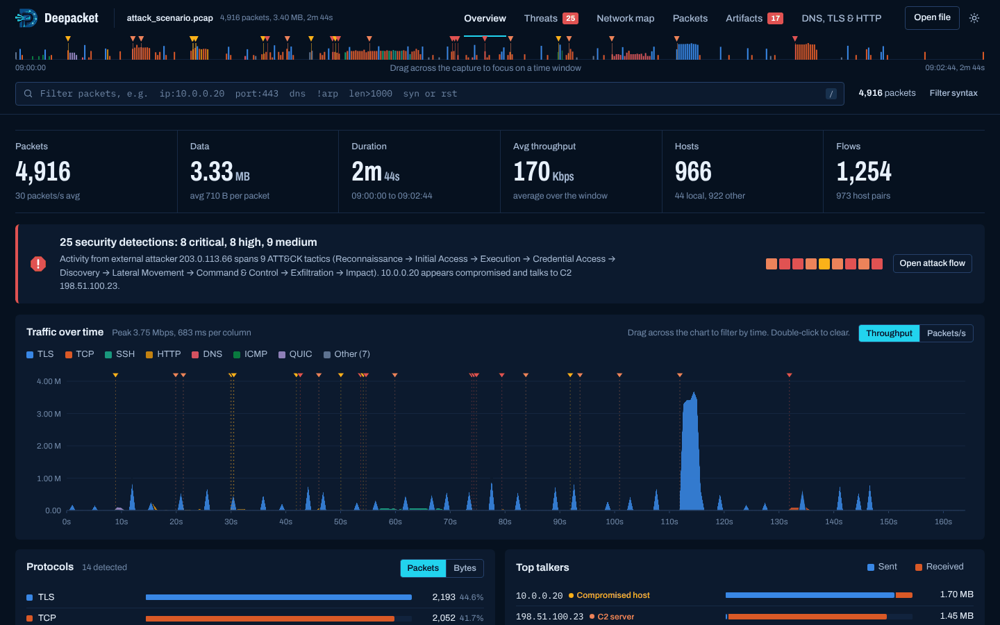
</p>

---

## Contents

- [Why Deepacket](#why-deepacket)
- [Quick start](#quick-start)
- [Features](#features)
  - [Overview](#overview)
  - [Threats and attack flow](#threats-and-attack-flow)
  - [Network map](#network-map)
  - [Packets](#packets)
  - [Artifacts](#artifacts)
  - [DNS, TLS and HTTP](#dns-tls-and-http)
- [How to work with it](#how-to-work-with-it)
- [Filter syntax](#filter-syntax)
- [Detections](#detections)
- [Supported captures](#supported-captures)
- [The sample capture](#the-sample-capture)
- [Privacy](#privacy)
- [Development](#development)
- [Project layout](#project-layout)
- [Limitations](#limitations)

## Why Deepacket

Wireshark tells you what every packet says. Deepacket tells you what happened. Drop in a `.pcap` or `.pcapng` and within seconds you see:

- the shape of the traffic and who the busy hosts are,
- whether an attack is in the capture, which machines played which role, and every step in order,
- the files, passwords and indicators that crossed the wire, ready to hand to your threat-intel tools.

It is a single HTML file with no server, no install and no network requests. The capture never leaves your machine.

## Quick start

**Online:** open **https://avijw96.github.io/deepacket/** and drop a capture on the page. The site is the same single HTML file served by GitHub Pages; your capture is still decoded locally and never uploaded.

**Offline:** download [`dist/deepacket.html`](dist/deepacket.html), open it in Chrome, Edge, Firefox or Safari, and drop a capture anywhere on the page or click **Choose a capture file**.

Want to see it work first? Click **Open the sample attack** on the start page. It loads a built-in capture containing a full intrusion.

<p align="center">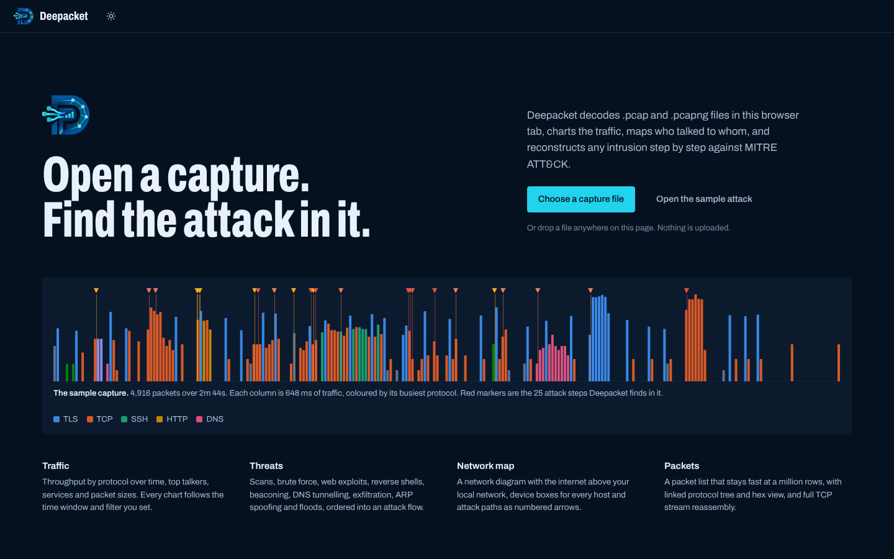</p>

## Features

### Overview

Headline numbers (packets, data, duration, throughput, hosts, flows), stacked traffic over time by protocol with markers where attacks happened, protocol mix, top talkers split into sent and received, services by server port, packet-size distribution and TCP flag counts.

The **capture strip** under the header shows the whole capture at a glance, one column per moment coloured by its busiest protocol, with red markers for attack steps. Drag across it (or across the traffic chart) to focus every view on that time window.

<p align="center">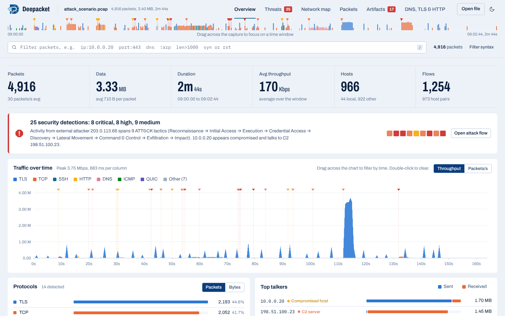</p>

### Threats and attack flow

Every detection is mapped to a MITRE ATT&amp;CK technique, ranked by severity and linked to its evidence packets.

- **What happened**: a plain-language summary of the incident.
- **Kill chain**: the nine ATT&amp;CK tactics in attack order, lit up where activity was found. Select one to narrow the list.
- **Attack flow**: a sequence diagram with one column per actor (attacker, compromised host, C2 server, victims) and a numbered arrow per step in time order.
- **Detection cards**: what was seen, the evidence (sample requests, commands typed in a reverse shell, ports found open), whether it looks successful, and buttons to show the packets or follow the TCP stream.

<p align="center">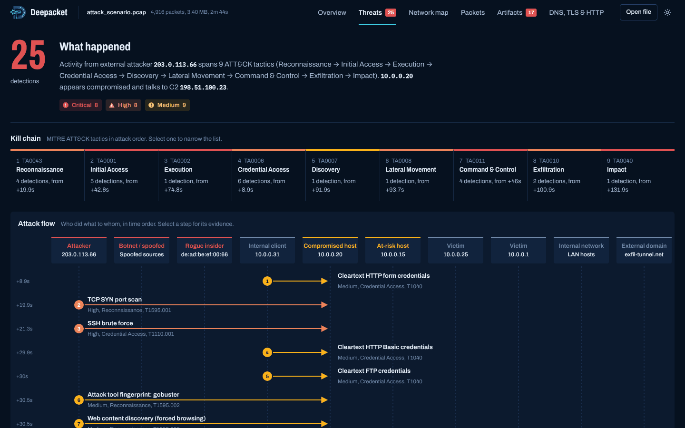</p>
<p align="center">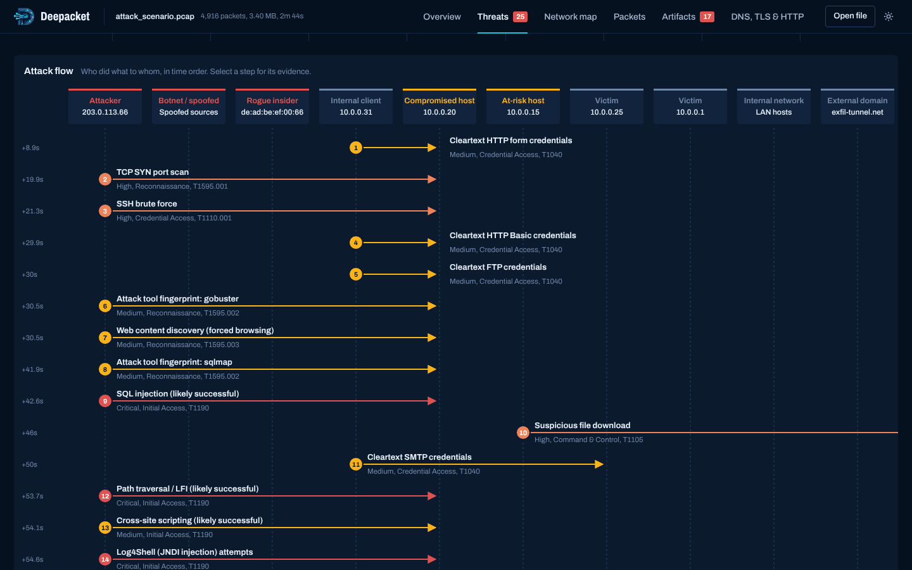</p>

### Network map

A network diagram drawn the way you would sketch it in draw.io: the internet above your local network, a box per device with an icon for its kind (gateway, server, workstation, internet host), connectors routed at right angles through the gaps between boxes, and attack paths drawn as coloured arrows carrying the numbers of the attack steps. Hosts that only talked to one machine are folded into "+N hosts" groups. Boxes can be dragged; hover a host to see its traffic, double-click to filter to it.

<p align="center">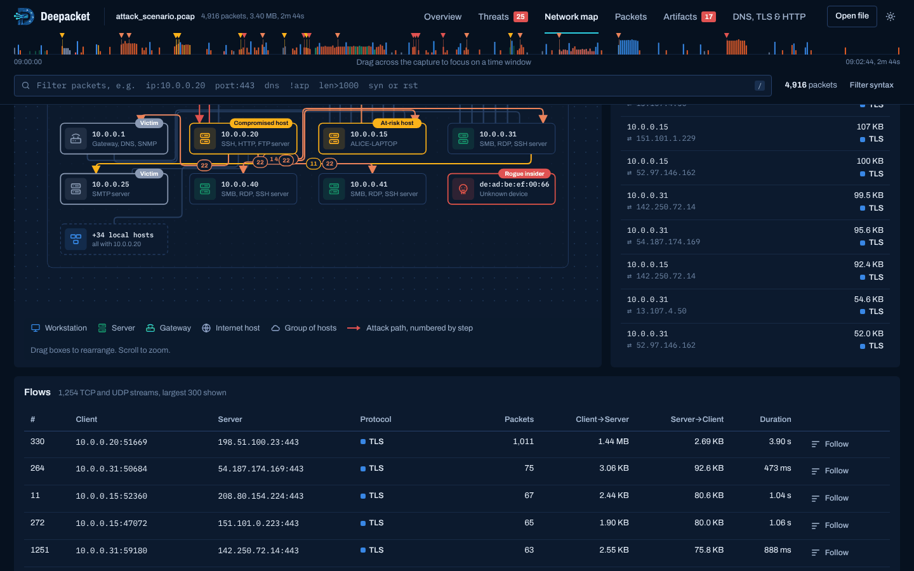</p>

### Packets

A virtualized packet list that stays responsive on large captures, a Wireshark-style [filter bar](#filter-syntax), a protocol tree linked both ways to a hex view (hover a field to highlight its bytes, click a byte to find its field), and full TCP stream reassembly with client and server coloured separately. Packets that are evidence in a detection carry a severity marker.

<p align="center">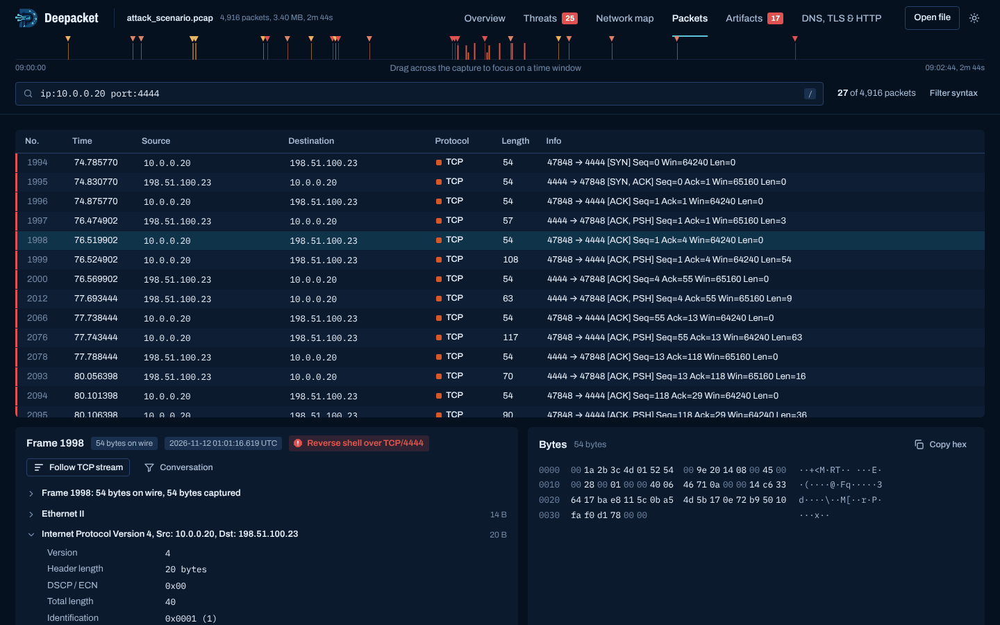</p>

### Artifacts

Everything worth keeping from the capture, in four parts.

**Files.** Reassembled from HTTP (including chunked and gzip-encoded bodies, form and multipart uploads), FTP data channels, SMTP attachments and raw TCP transfers. Each file shows its real type from its contents, its size, where it came from, MD5 and SHA-256 hashes and a VirusTotal lookup link. Executables and scripts are flagged, and an executable pretending to be an image or document is flagged critical. Images open in a gallery. Executables are never rendered and are saved inside a .zip so they cannot be opened by accident.

<p align="center">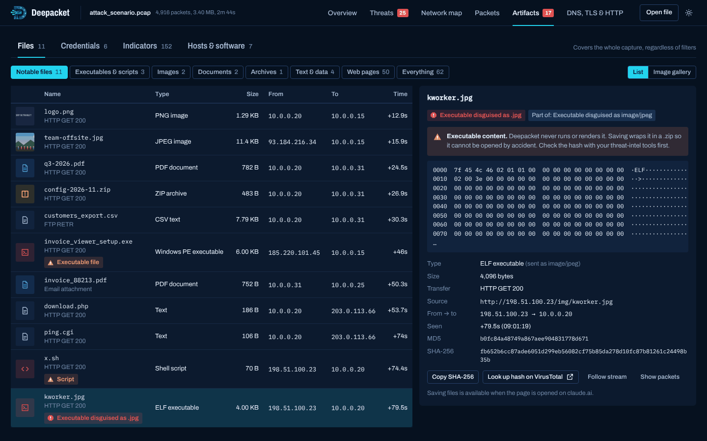</p>
<p align="center">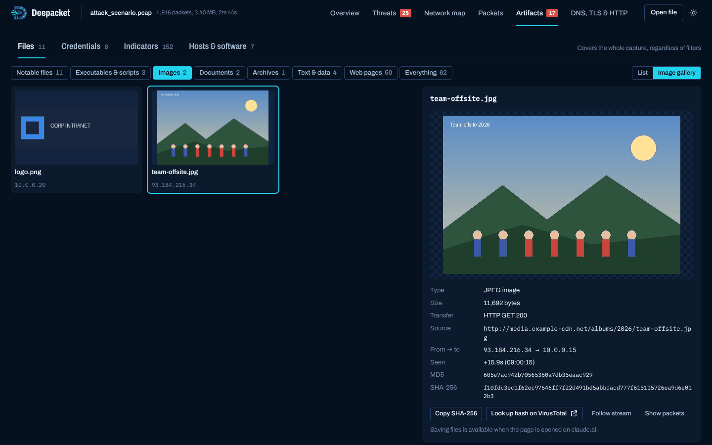</p>

**Credentials.** Logins and secrets that crossed the network in cleartext: HTTP Basic and login forms, FTP, POP3, IMAP, SMTP AUTH, Telnet sessions, SNMP community strings, bearer tokens and API keys, and passwords, keys or private-key blocks found in other cleartext traffic. Secrets are masked until you reveal them, and the list exports as CSV.

<p align="center">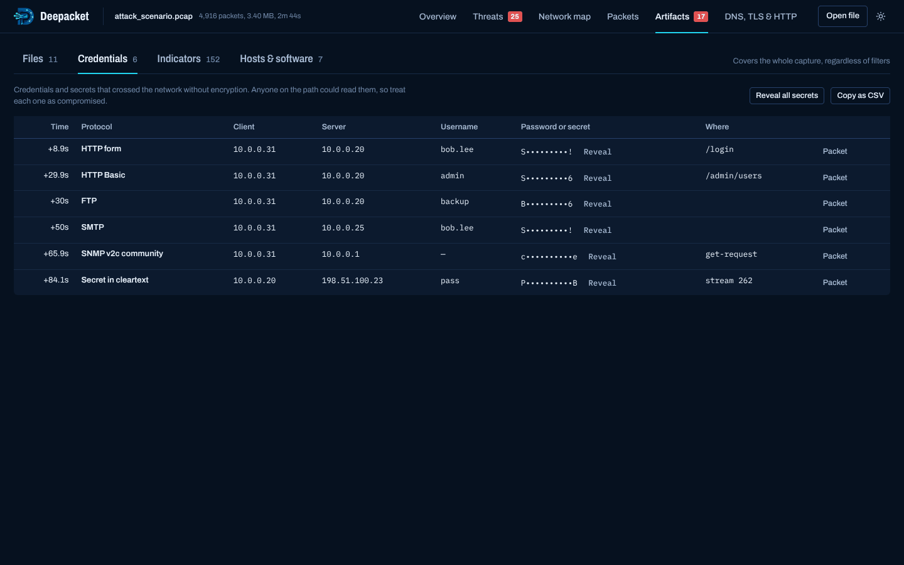</p>

**Indicators.** External IP addresses, domains (from DNS, TLS SNI and HTTP Host), URLs, user agents (attack tools flagged), email addresses and file hashes. Copy or save them all as text for a blocklist, SIEM search or threat-intel lookup.

<p align="center">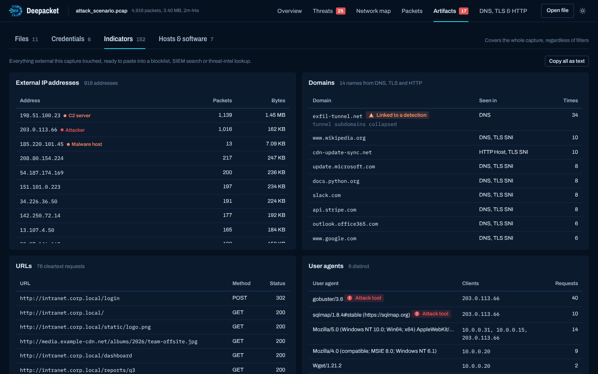</p>

**Hosts and software.** A host inventory: DHCP hostname, MAC address, likely operating system from TTL, services each host answered on, and software seen in banners and headers (web and SSH servers, FTP and mail servers, HTTP clients).

<p align="center">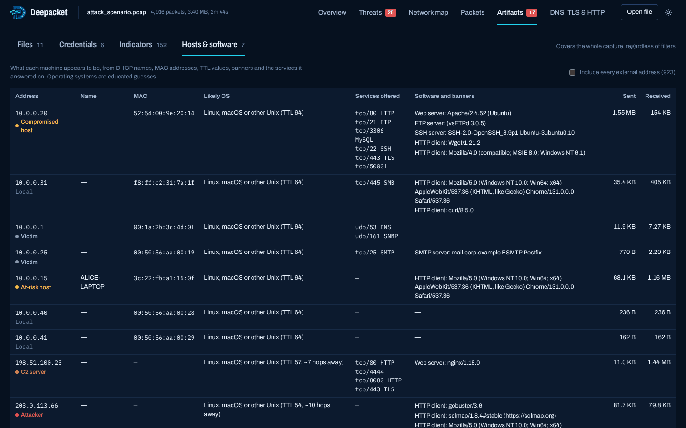</p>

### DNS, TLS and HTTP

Queried domains grouped by registered domain with their answers and NXDOMAIN counts, TLS server names with ALPN and bytes, and every cleartext HTTP request with status and user agent. Click a row to jump to its packets.

## How to work with it

A typical investigation:

1. **Open the capture.** Read the threat banner on the Overview. If it is clean, scan the timeline and top talkers for anything unexpected.
2. **Open the attack flow.** Read "What happened", then walk the numbered steps. The kill chain tells you how far the attacker got.
3. **Check each detection.** Use **Show packets** to see the evidence and **Follow stream** to read the conversation (for example, the commands typed in a reverse shell).
4. **Look at the network map** to see which machines were involved and which internal hosts the attacker reached.
5. **Collect artifacts.** Hash and save suspicious files, list the exposed credentials that need resetting, and copy the indicators into your blocklist or SIEM.
6. **Dig deeper with filters.** For example `ip:10.0.0.20 !tls`, `dns:exfil`, `status>=400`, or `threat` to see only evidence packets.

Keyboard: `/` focuses the filter, arrow keys and Page Up/Down move through the packet list, `Esc` closes dialogs.

## Filter syntax

Terms are combined with AND. Use `or` between groups and prefix a term with `!` to negate it. Operators: `:` `==` `!=` `>` `<` `>=` `<=`.

| Filter | Matches |
|---|---|
| `tcp` `udp` `dns` `tls` `http` `arp` `smb` … | Protocol name |
| `ip:10.0.0.5`, `ip:10.0.0.0/24`, `src:` `dst:` | Either address, a subnet, source or destination |
| `port:443`, `dport<1024`, `sport:53` | Ports |
| `len>1000`, `ttl<10`, `frame>=500`, `time>30` | Numeric comparisons |
| `syn` `synack` `rst` `fin` | TCP flags |
| `stream:12` | One TCP or UDP conversation |
| `dns:example.com`, `sni:github`, `http:login`, `ua:sqlmap`, `status>=400` | Application fields (substring) |
| `threat` | Packets that are evidence in a detection |
| `mac:aa:bb:cc:dd:ee:ff`, `vlan:10` | Link layer |
| anything else | Text search in addresses and the Info column |

Example: `ip:10.0.0.20 !tls port:80 or dns`

## Detections

| Area | What is detected | ATT&amp;CK |
|---|---|---|
| Reconnaissance | SYN, NULL, FIN, Xmas and UDP port scans (with open ports found), horizontal scans, ping and ARP sweeps, attack-tool user agents, forced browsing | T1595, T1046, T1018 |
| Initial access | SQL injection, XSS, path traversal, command injection, Log4Shell, Shellshock, Heartbleed, with signs of success read from the response | T1190 |
| Credential access | SSH, FTP, RDP, SMB, database and web-login brute force; cleartext credentials; ARP spoofing; rogue DHCP | T1110, T1040, T1557 |
| Execution | Interactive and reverse shells over TCP, with the commands issued | T1059.004 |
| Lateral movement | Internal hosts probing other internal hosts on SMB, RDP, SSH, WinRM or VNC | T1021 |
| Command and control | Periodic beaconing, sessions on backdoor ports, tool and stager downloads, executables disguised as other file types, NXDOMAIN bursts (DGA), ICMP tunnels | T1071, T1571, T1105, T1036.008, T1568.002, T1095 |
| Exfiltration | DNS tunnelling (with an estimate of the data encoded), large outbound transfers | T1048.003, T1041 |
| Impact | SYN floods (including spoofed sources), ICMP floods, DHCP starvation | T1498, T1499 |

Detection is heuristic. A clean result does not prove the traffic is benign, and every finding should be confirmed against its evidence packets.

## Supported captures

- **pcap**: micro- and nanosecond timestamps, either byte order.
- **pcapng**: multiple interfaces, any timestamp resolution, enhanced, simple and obsolete packet blocks.
- **Compressed**: `.pcap.gz` and other gzip-wrapped captures are unpacked automatically.
- **Link types**: Ethernet (with 802.1Q and QinQ tags), Linux cooked v1 and v2, raw IP, BSD loopback.
- **Protocols decoded**: Ethernet, ARP, IPv4, IPv6 (with extension headers), TCP, UDP, ICMP, ICMPv6, DNS, mDNS, LLMNR, NBNS, DHCP, NTP, SNMP, TLS (ClientHello SNI and ALPN, ServerHello version), QUIC, HTTP/1.x, SSH, FTP, SMTP, POP3, IMAP, Telnet, SSDP, STUN, plus port-based labels for many more.

## The sample capture

[`samples/attack_scenario.pcap`](samples/attack_scenario.pcap) is generated, not recorded, so it is safe to share. It mixes normal office traffic with a scripted intrusion:

1. External attacker `203.0.113.66` port-scans the web server `10.0.0.20`, then runs gobuster and sqlmap against it.
2. SQL injection, path traversal (leaking `/etc/passwd`), XSS and Log4Shell probes, then an SSH brute force.
3. A command injection makes the server download a stager and open a reverse shell to C2 `198.51.100.23`; the attacker reads config files, and a second payload disguised as a `.jpg` is fetched.
4. The server beacons to the C2 every 10 seconds, sweeps the LAN and tries SMB, RDP and SSH on other hosts.
5. Customer data leaves through DNS tunnelling and a 1.4 MB upload to the C2, while a rogue insider spoofs the gateway's ARP entry and a SYN flood hits the web server.

It also carries images, PDFs, a ZIP, an FTP export, an email with an attachment and several cleartext logins, so every Artifacts view has something to show. The "executables" in it are harmless stand-ins with only the MZ or ELF header shape and a note, and all addresses are private or from documentation ranges.

Regenerate it with `npm run sample` (needs Python with scapy and Pillow). The output is byte-for-byte reproducible.

## Privacy

Deepacket makes no network requests. The fonts and the sample are embedded in the HTML file, and captures are decoded with JavaScript in the page. Nothing you open is uploaded or stored. The only links that leave the page are the MITRE ATT&amp;CK technique links and the VirusTotal hash lookups, which open in a new tab and send only the technique ID or hash.

## Development

Requirements: Node 20 or newer for the tests and Python 3.10 or newer for the build.

```sh
npm test                # engine tests (parser, detections, artifacts)
npm run build           # rebuild dist/deepacket.html after editing src/
npm run test:browser    # browser smoke test; needs `pip install playwright` and Chromium
npm run sample          # regenerate samples/attack_scenario.pcap (needs scapy and Pillow)
```

Edit files in `src/`, run `npm run build`, and commit the rebuilt `dist/deepacket.html` together with your source changes. Every push to `main` that changes `dist/` redeploys the live site through `.github/workflows/pages.yml`. CI runs the tests and `python3 tools/build.py --check`, which fails if the committed bundle is stale.

## Project layout

```
src/
  core.js         capture readers (pcap, pcapng) and protocol dissectors
  analysis.js     streams, aggregation, threat detection, attack-flow model
  artifacts.js    TCP reassembly, file carving, credentials, indicators, host inventory
  ui.js           views, filters, packet inspector, threats
  graph.js        network map
  strip.js        capture strip and start-page preview
  art.js          Artifacts view
  style.css       theme (navy and cyan, from the logo)
  shell.html      page template
assets/           logo
fonts/            Archivo and IBM Plex Mono (SIL Open Font License), embedded at build time
samples/          attack_scenario.pcap
tools/
  build.py          bundles everything into dist/deepacket.html
  gen_attack_pcap.py  generates the sample capture
tests/
  engine.test.mjs   engine tests for Node's built-in test runner
  smoke_browser.py  browser smoke test (Playwright)
docs/screenshots/ images used in this README
dist/             the built single-file app (generated, committed)
```

## Limitations

- Encrypted traffic (TLS, SSH, QUIC) can be measured and attributed but not read, so files and credentials inside it cannot be recovered.
- Very large captures are limited by browser memory; a few hundred MB works on most machines.
- 802.11 and radiotap captures are listed but not decoded.
- IP fragments are shown but not reassembled.
- Operating-system guesses come from TTL values and are approximate.
